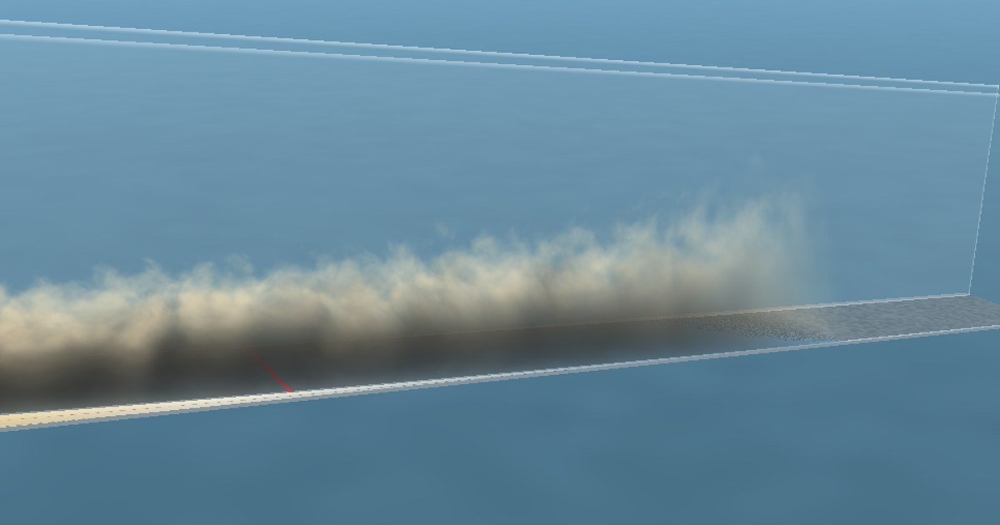

# GeoFluxSim

**A turbidity-current lab you can open in your browser.**

GeoFluxSim was built with the assistance of Claude, an AI model by Anthropic, which helped write the code, documentation and promotional video. The physics, requires further revision and tested the results. The equations come from the published literature, but the model is simplified and not yet validated against experiments, so please treat it as a teaching and exploration tool and let me know if anything looks wrong.

GeoFluxSim runs mixed carbonate–siliciclastic turbidity currents down a 3D flume. You can watch the flow, see velocity and concentration inside it, read the layered deposit it leaves behind, and follow every governing equation live as you change the sediment, the water and the flow.

**Try it:** 
(https://wakandageoscientist.github.io/geofluxsim/)

**Project page:** https://davidnworie.com/geofluxsim/



## Why it exists

Turbidity currents are underwater avalanches of sediment. They shape the deep sea and build some of the largest deposits on Earth, yet they are almost impossible to watch in the ocean, and flume experiments are rare and slow to set up. GeoFluxSim lets students, teachers, researchers and industry geoscientists explore these flows in seconds, with no installation.

## What you can do

| | |
|---|---|
| **Watch the flow** | A realistic 3D current travelling the length of an 8 m flume, with orbit, side-wall and probe-camera views. |
| **See inside it** | Colour the current by velocity or concentration, cut open along the flume's centre line, with the profile at your probe drawn in white. |
| **Read the deposit** | The bed builds up in 1.5 s layers: cross-section with time lines, a core at any position, and downstream thickness, composition and grain size. |
| **Ask "what if?"** | Change grain size, density, shape and sorting, carbonate fraction, water temperature and density, slope, inflow and model coefficients. |
| **Check the physics** | A live force-and-flux diagram and every equation with its current value at the probe. |

<p>


</p>
<p>


</p>

## Who it is for

- **Students:** see the processes your textbook describes.
- **Teachers:** show it in class, no flume needed.
- **Researchers:** test ideas and plan experiments before booking lab time.
- **Industry geoscientists:** explore where sand goes in deep-water systems.

## Run it

**In the browser:** [open](https://wakandageoscientist.github.io/geofluxsim/). 

It needs a browser with WebGL (current Chrome, Edge, Firefox or Safari, including phones) and works best on a laptop or desktop.

**Locally:** download `index.html` and double-click it. No server, build step or installation is needed.

**In Jupyter:** copy `notebooks/geofluxsim_jupyter.py` into a single notebook cell and run it. It needs `numpy`, `matplotlib` and `ipywidgets`:

```bash
pip install numpy matplotlib ipywidgets
```

## How the model works

The current is a layer-averaged gravity flow (Parker et al., 1986) carrying six grain classes: siliciclastic and carbonate, each split into fine, median and coarse sizes set by the sorting. It entrains ambient water, is driven downslope by its excess density and loses momentum to bed friction. Each class settles at its own Ferguson & Church (2004) velocity with Richardson–Zaki hindered settling. Settled sediment is stored layer by layer, so the deposit keeps its internal stratigraphy.

Full equations, numerical method, assumptions and references: [docs/physics.md](docs/physics.md).

**Limitations.** GeoFluxSim is a simplified, width-averaged model for teaching, exploration and experiment planning. It does not resolve turbulence, bed erosion or lateral spreading, and the 3D billows are a visual rendering of the layer state, not a turbulence simulation. Use it to build intuition, not as a substitute for experiments or field data.

## Repository layout

```
index.html                     the web app (one self-contained file)
preview.jpg                    link-preview image
notebooks/geofluxsim_jupyter.py  Jupyter version (same physics)
docs/physics.md                equations, numerics, assumptions, references
docs/release-checklist.md      what to test before each release
assets/                        screenshots for this README
netlify.toml                   Netlify publishing settings
CHANGELOG.md                   what changed in each version
CITATION.cff                   how to cite GeoFluxSim
```

## Updating the live site

The site at geofluxsim.netlify.app is published from this repository. Every change pushed to `main` goes live within about a minute. Before you push, run through [docs/release-checklist.md](docs/release-checklist.md) and add a line to [CHANGELOG.md](CHANGELOG.md).

## Feedback and contributions

Found a bug, have an idea, or used GeoFluxSim in a class? Please [open an issue](../../issues/new/choose). See [CONTRIBUTING.md](CONTRIBUTING.md) for how to suggest changes.

## Citing GeoFluxSim

If you use GeoFluxSim in teaching or research, please cite it. GitHub's **Cite this repository** button (on the right of the repository page) gives the citation from [CITATION.cff](CITATION.cff).

## Licence

Released under the MIT Licence. See [LICENSE](LICENSE).
